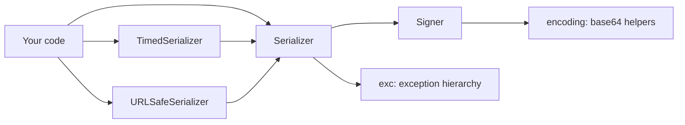

# X-Ray: itsdangerous

- **Repository:** https://github.com/pallets/itsdangerous @ 672971d
- **Scanned:** 2026-11-16 · **Mode:** Quick
- **Stack (observed):** Python ≥3.10, zero runtime dependencies, flit build
  backend (from `pyproject.toml`)
- **Coverage:** Read in full: 2 files (`pyproject.toml`,
  `src/itsdangerous/__init__.py`) · Sampled: `src/itsdangerous/serializer.py`
  (class map), full inventory of all files · Executed but not read: the test
  suite · Not opened: docs prose, changelog history, remaining module bodies —
  module roles below come from the public exports in
  `src/itsdangerous/__init__.py` plus spot checks · Total counted: 50 files,
  16 code files, 1,729 LOC

> This is a real output produced by following SKILL.md, kept deliberately
> honest about its Quick-mode coverage. A Deep scan would read every module
> body before characterising it.

## 1. Run it

### Install
Status: VERIFIED — editable install succeeded in a fresh venv (Python 3.12.3)
```
python3 -m venv .venv && .venv/bin/pip install -e .
```

### Run
Library: no runnable entry point — it is imported, not executed.
Minimal use: `from itsdangerous import Serializer`.

### Test
Status: VERIFIED — 297 passed in 0.83s, after one fix (see Landmine 1):
a bare editable install fails collection with
`ModuleNotFoundError: No module named 'freezegun'` in
`tests/test_itsdangerous/test_timed.py`; installing the test dependency
group's `freezegun` makes the suite green.
```
.venv/bin/pip install freezegun && .venv/bin/python -m pytest -q
```

## 2. Architecture



A small, single-purpose signing library (the Pallets signing toolkit used
across the Flask ecosystem): it serialises data and signs it so tampering
is detectable, optionally with a timestamp for expiry. Module roles, from
the public API surface in `src/itsdangerous/__init__.py`:

- `src/itsdangerous/serializer.py` — the core `Serializer`: dumps/loads,
  delegates signing to a `Signer`.
- `src/itsdangerous/signer.py` — `Signer` plus `HMACAlgorithm` /
  `NoneAlgorithm`: key derivation and signature computation.
- `src/itsdangerous/timed.py` — `TimedSerializer` / `TimestampSigner`:
  embeds a timestamp, enforces `max_age` on load.
- `src/itsdangerous/url_safe.py` — URL-safe variants of both serializers.
- `src/itsdangerous/encoding.py` — base64 encode/decode helpers.
- `src/itsdangerous/exc.py` — the `BadData` / `BadSignature` /
  `SignatureExpired` exception hierarchy callers catch.

No data stores, no services, no I/O: pure computation, zero runtime
dependencies.

## 3. Change index

| To change… | Touch | Prove it with |
|---|---|---|
| Signing algorithm or key derivation | `src/itsdangerous/signer.py` | `tests/test_itsdangerous/test_signer.py` |
| Serialisation format | `src/itsdangerous/serializer.py`, `src/itsdangerous/_json.py` | `tests/test_itsdangerous/test_serializer.py` |
| Timestamp / expiry behaviour | `src/itsdangerous/timed.py` | `tests/test_itsdangerous/test_timed.py` |
| Public API surface | `src/itsdangerous/__init__.py` | full test suite |
| Add an exception type | `src/itsdangerous/exc.py`, `src/itsdangerous/__init__.py` | full test suite |

## 4. Landmines

1. **The test suite doesn't run from a bare `pip install -e .`** —
   `freezegun` is declared in the project's test dependency group
   (`pyproject.toml`, line 47) which the uv/tox flow installs but plain
   pip doesn't. Observed directly: collection of
   `tests/test_itsdangerous/test_timed.py` fails with ModuleNotFoundError.
   Contributors outside the uv flow hit this first.
2. **`NoneAlgorithm` is a loaded foot-gun** — `src/itsdangerous/signer.py`
   exports an algorithm that produces *unsigned* payloads, and it is part
   of the public API (`src/itsdangerous/__init__.py`). Anyone configuring
   a signer by name can switch signing off entirely; know it exists before
   you expose algorithm choice to configuration.
3. **Docs are a separate toolchain** — `docs/Makefile` and
   `.readthedocs.yaml` indicate a Sphinx build that nothing in the test
   flow exercises (observed, not verified locally): doc changes can break
   the docs build while the whole test suite stays green.

## 5. Reading path

1. `src/itsdangerous/__init__.py` — the entire public API in one screen;
   tells you what the library promises.
2. `src/itsdangerous/signer.py` — the core primitive: keys, algorithms,
   sign/unsign. Everything else builds on it.
3. `src/itsdangerous/serializer.py` — the main flow: how data becomes a
   signed token and back, and where the signer plugs in.
4. `src/itsdangerous/timed.py` — the subtle one: timestamp embedding and
   expiry checks, the easiest place to misunderstand behaviour.
5. `tests/test_itsdangerous/test_serializer.py` — intended behaviour as
   executable examples, including the failure modes callers must catch.
